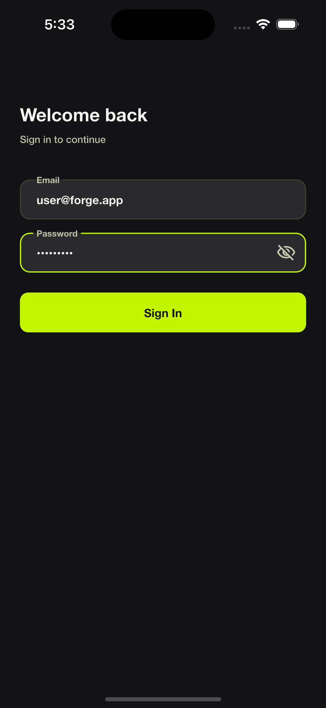
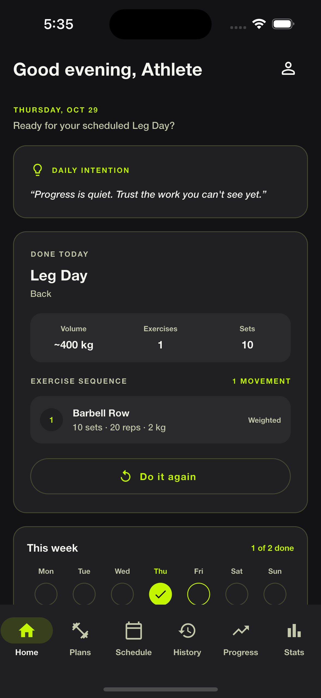
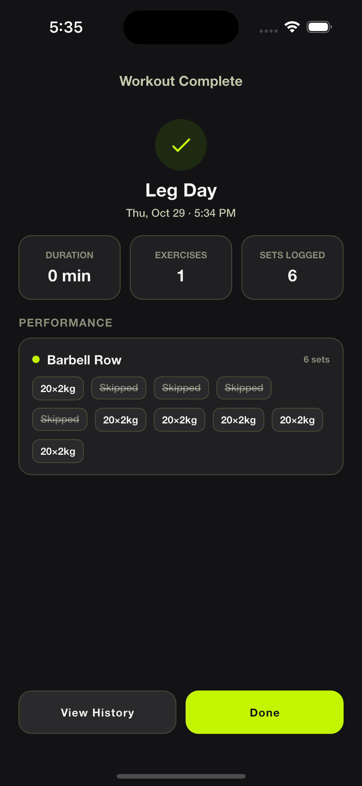
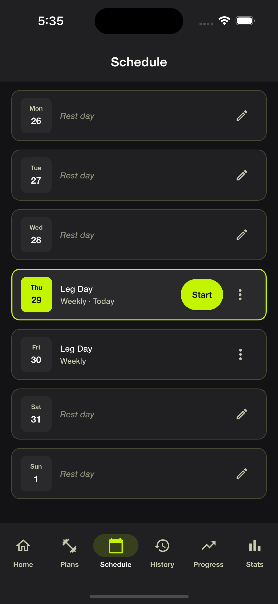
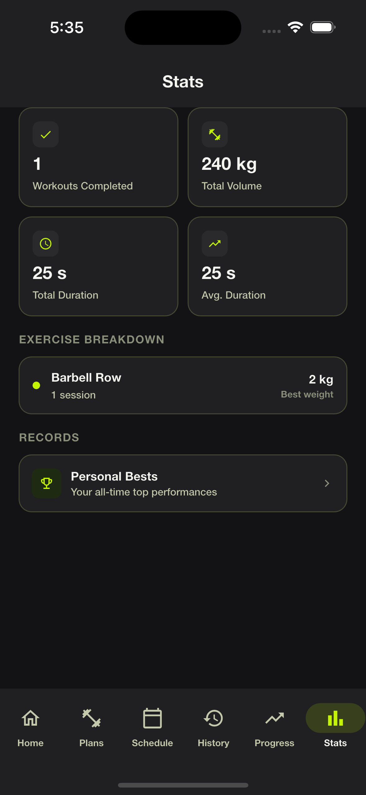

# Forge

A workout planner and tracker for iOS and Android, built with Flutter. Forge covers the full training loop on one device, **plan → schedule → perform → record → review → progress**, and works completely offline.

> Forge is a scoped POC/MVP. It is single-user and single-device, with no backend, accounts, cloud sync or network calls. It is a focused tracker, not a coaching, social or health-data platform.

## Screenshots

      
    
   

## Key features

**Workout plans**
- Create, edit and delete plans from a built-in exercise catalogue.
- Three exercise types, each with its own targets: **weighted** (sets, reps, weight), **bodyweight** (sets, reps) and **time-based** (sets, duration as mm:ss). Every exercise also has a rest period.
- Shared validation limits, for example sets 1–100, reps 1–1000, weight up to 1000 kg, and a plan name of at most 100 characters. Errors are shown in one readable message per exercise, and the form scrolls to the first problem.

**Scheduling**
- Assign a plan to weekdays. One plan per day, and a conflicting assignment is rejected.
- A weekly schedule view where you can change days, remove a plan from a day, or start today's workout.

**Home dashboard**
- Today's plan with estimated time, volume and the exercise list, a "Done today" state once it is completed, and "Do it again" with a confirmation before a second run.
- A week strip showing completed, planned, missed and rest days, plus the last workout and a daily intention.
- A "Create your first workout plan" card when no plans exist yet.

**Workout execution**
- Pre-start overview, then set-by-set logging of reps, weight and duration against the planned targets, with skip support.
- An auto-starting, skippable rest timer, and a cancel confirmation that discards everything.
- A summary screen at the end that saves the session in one transaction.

**History, progress and statistics**
- Workout history with detail, plus edit and delete of logged workouts. Statistics refresh straight away.
- Progress comparison: the latest session against the previous one for the same exercise (weight, reps, volume, duration) with a trend chart.
- Statistics (total workouts, training volume, exercise breakdown) and personal bests per exercise.

**Profile and account**
- An editable profile: display name, fitness goal, experience level, height and weight.
- A static local login. Logging out **permanently deletes** the profile, plans, schedules and history from the device, after a confirmation.

**Rules that hold everywhere**
- Plans (intent) and workout records (actuals) are separate. Editing or deleting a plan never changes history.
- Training volume = weight × reps. Skipped or invalid sets never count towards any statistic.
- One shared definition of a "completed" set and workout feeds history, progress, statistics and personal bests.

## Architecture

Forge uses a **clean, feature-first architecture**. Each feature owns four layers under `lib/features/<feature>/`:

```
domain/         entities, repository interfaces, rules (no Flutter or Drift)
application/    Blocs, events, states, use cases
data/           Drift data sources, models, mappers, repository implementations
presentation/   screens and widgets (render state, dispatch events)
```

Dependencies point inwards: `domain` imports nothing from the other layers, `application` uses `domain`, `data` implements `domain`, and `presentation` uses `application` and `domain` but never `data`.

| Concern | Choice |
|---|---|
| State management | `flutter_bloc`: **Bloc only**, no Cubit |
| Routing | `go_router` with a stateful bottom-navigation shell |
| Dependency injection | `get_it` (`lib/app/get_it_setup.dart`) |
| Persistence | `drift` (SQLite) with CHECK constraints, foreign keys and transactional writes |
| Error handling | `fpdart` `Either` returned from repositories and use cases |
| Theme | A single fixed dark theme; colours, spacing, radii and text styles are tokens in `lib/core/theme/` |
| Strings | All user-facing text comes from the ARB file (`lib/l10n/app_en.arb`) |

```
lib/
├── app/          app widget and dependency injection
├── config/       app config and routes
├── core/         database, theme, shared widgets, validation, formatters, navigation signals
├── features/     home, workout_plan, schedule, workout_session, progress,
│                 stats, personal_bests, exercise, profile, auth
├── l10n/         ARB file and generated localisations
└── main_<flavor>.dart
```

Tabs that stay mounted refresh through small reload notifiers (for example after a plan is deleted or a workout is saved), so Home, Plans, Schedule, History, Progress and Stats never show stale data.

## Flavors and builds

Three flavors (`development`, `staging`, `production`) each have their own entry point, application ID and app name, so they can be installed side by side.

```bash
flutter run --flavor development -t lib/main_development.dart
flutter build apk --release --flavor production -t lib/main_production.dart
flutter build ipa --release --flavor production -t lib/main_production.dart
```

See [FLAVORS.md](FLAVORS.md) for every build command, outputs, signing notes and troubleshooting.

## Getting started

Requirements: Flutter with Dart SDK `^3.12.2`, and Xcode (iOS) or the Android SDK (Android).

```bash
flutter pub get
dart run build_runner build --delete-conflicting-outputs   # Drift code generation
flutter gen-l10n                                           # localisations
flutter run --flavor development -t lib/main_development.dart
```

The splash screen is generated from `assets/images/splash_icon.png`. After changing its settings in `pubspec.yaml`, run `dart run flutter_native_splash:create`.

## Testing

```bash
flutter analyze
flutter test
```

The suite has more than 900 tests covering use cases, Blocs, repositories, an in-memory Drift database, widgets and an end-to-end statistics flow. Four tests currently fail and are known: three in `login_screen_test.dart` and the template `widget_test.dart`.

## How Forge was built

- **Spec-Driven Development (SDD).** Features were specified before they were coded, using SpecKit. Each screen has a user story, a design spec, a QA spec, and a plan, tasks and data model, all under [`../specs/`](../specs). Governance documents, 40 ADRs and the SDD prompts are in [`../Doc/Mobile/`](../Doc/Mobile).
- **ChatGPT for documents and requirements.** The basic documents were drafted and refined with ChatGPT: the BRD, PRD, business discovery document, SRS, SDS, screen-flow and use-case inventory, and the user stories.
- **Claude for coding and UI design.** The implementation, the tests, the UI and the design system were built with Claude (Claude Code). The design system is documented in [`../Doc/Design/`](../Doc/Design).

## Project documentation

All paths are relative to this folder.

| Area | Location |
|---|---|
| Business and product documents (BRD, PRD, business discovery, SRS, SDS, screen flow, user stories) | [`../Doc/Product/`](../Doc/Product) |
| Per-screen user stories | [`../Doc/UserStories/`](../Doc/UserStories) |
| Design system | [`../Doc/Design/`](../Doc/Design) |
| Architecture decisions (ADRs), governance, coding and testing standards, SDD prompts | [`../Doc/Mobile/`](../Doc/Mobile) |
| Feature specs, plans, tasks and QA specs | [`../specs/`](../specs) |
| Agent and coding rules | [`../CLAUDE.md`](../CLAUDE.md) |
| Builds and flavors | [FLAVORS.md](FLAVORS.md) |

## Status

Forge is a POC/MVP. The deferred decisions are the exact personal-best metric and how the timer behaves when the app is in the background. The `com.example.*` identifiers, release signing and the placeholder environment URLs still need real values before a store release.
